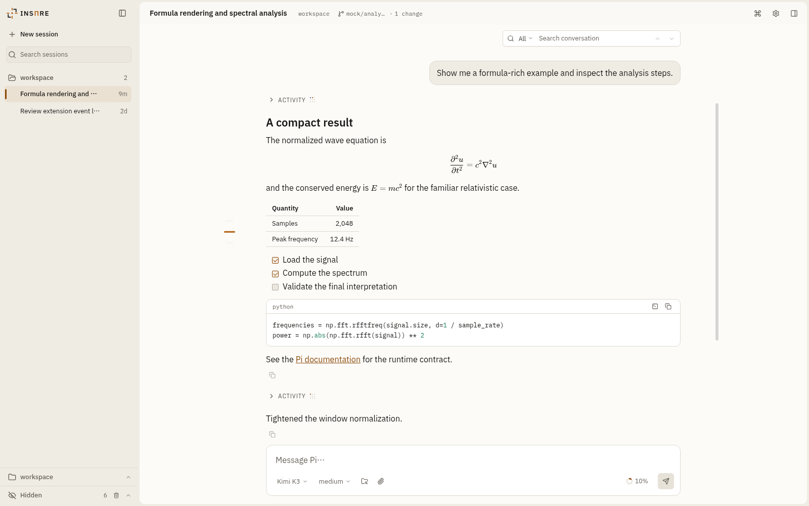
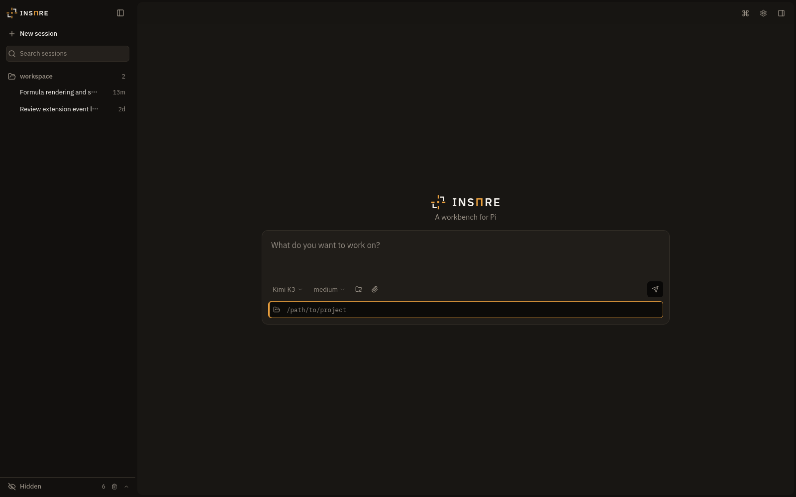
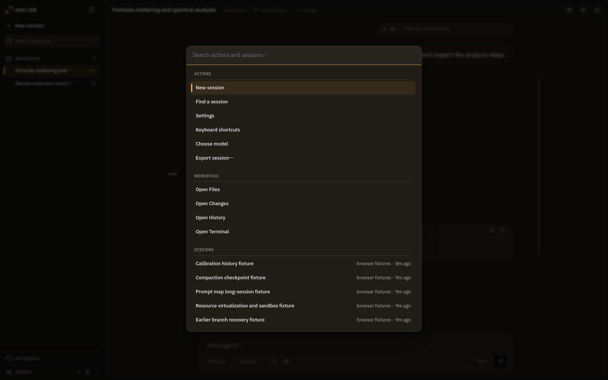
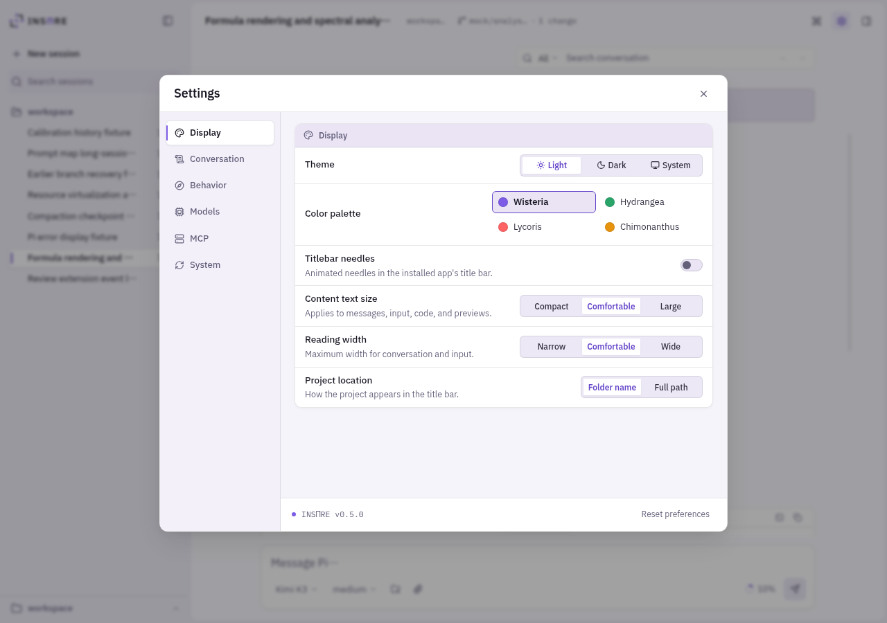
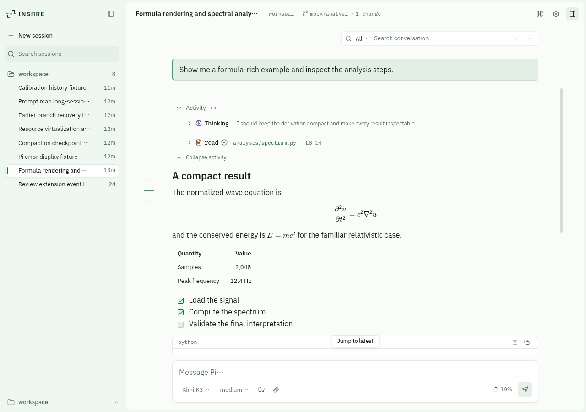
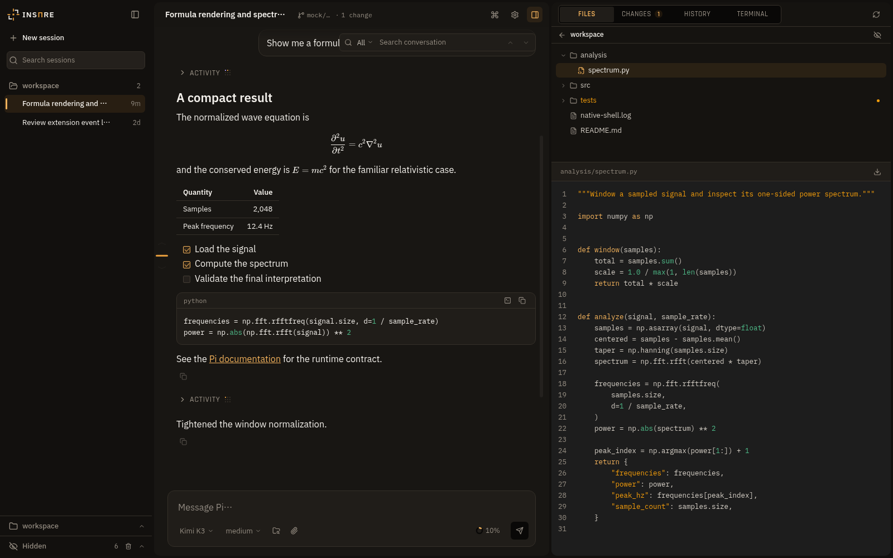
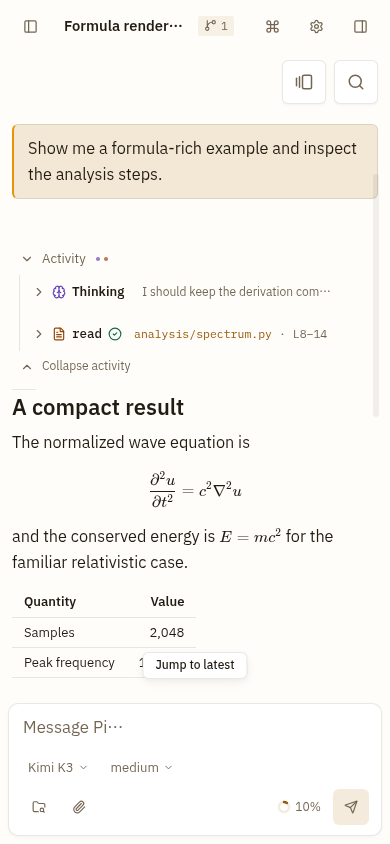

# INSΠRE

Inspire is a local graphical workbench for [Pi Coding Agent](https://github.com/earendil-works/pi): conversations, tool activity, files, and terminals in one interface. It uses your installed Pi, existing configuration, and native session records.

The **Host** runs on the machine with Pi and your projects; the browser is its interface. Tools,
prompts, models, credentials and extensions remain configured in Pi. You can use a local browser or
connect remotely to the same Host.

[Install and run](#run-locally) · [Your first session](#your-first-session) ·
[User guides](#pi-commands-and-customization) · [Host operations](docs/host.md)

<picture>
  <source media="(prefers-color-scheme: dark)" srcset="docs/screenshots/conversation-dark.png">
  
</picture>

## Features

- **Technical conversations:** streaming Markdown, syntax-highlighted code, tables, and inline/display mathematics, with search and a prompt outline.
- **Concurrent sessions:** search retained conversation text, inspect History, continue branches, and Fork/Clone independent sessions. Switching keeps background work running; navigation shows running work and unseen results.
- **Shared with terminal Pi:** a terminal Pi and Inspire can use the same session; **Take over** continues a running terminal Pi from the browser while the terminal keeps working.
- **Rich input:** project-file references, images/files, retained drafts and prompt history, plus Steer/Queue with text/image recovery during a run.
- **Native Pi controls:** model/thinking selection, saved defaults/common models, provider configuration/login, direct shell input, compaction, and HTML/JSONL export.
- **Inspectable activity:** live tool output, native and customizable tool cards, and independent Thinking/tool detail settings. Adaptive mode shows current work and compacts completed activity.
- **Files and Changes:** browse the workspace, inspect Git diffs, and preview images, Markdown, notebooks, HTML, PDF, source, audio, and video beside the conversation.
- **Persistent terminals:** project-scoped shell tabs survive browser disconnects and Host-only restarts.
- **Desktop and narrow layouts:** resizable panes, a command palette, keyboard shortcuts, and Wisteria, Hydrangea, Lycoris, Chimonanthus, Jade, Amber and Carbon & Silicon palettes, each in light and dark.

<table>
  <tr>
    <td></td>
    <td></td>
    <td></td>
  </tr>
  <tr>
    <td align="center"><em>New session</em></td>
    <td align="center"><em>Command palette</em></td>
    <td align="center"><em>Settings</em></td>
  </tr>
  <tr>
    <td></td>
    <td></td>
    <td></td>
  </tr>
  <tr>
    <td align="center"><em>Hydrangea palette</em></td>
    <td align="center"><em>Resources</em></td>
    <td align="center"><em>Narrow layout</em></td>
  </tr>
</table>

## Run locally

Requirements: **Node.js 22.19+** and a separately installed **Pi** available as `pi` on `PATH`.
Windows Hosts also need **PowerShell 7** (`pwsh`) on `PATH` or in its standard Program Files
location; the older built-in Windows PowerShell is not used.

If PowerShell script execution is disabled, use `npm.cmd`, `inspire.cmd` and `pi.cmd` instead of
the bare command names below (for example, `npm.cmd run inspire -- status`).

```bash
npm install -g --ignore-scripts @earendil-works/pi-coding-agent
```

### From source

Clone the repository and start it from the checkout root:

```bash
git clone https://github.com/XWIlluDelu/pi-inspire.git
cd pi-inspire
npm run inspire
```

The launcher installs dependencies and builds the client when needed, starts the loopback Host, and opens the browser. Later launches reuse the matching running instance. On Linux and macOS, `./inspire` is an equivalent wrapper.

Inspire targets the latest Pi release; `package.json` records the version used by development compatibility checks. The running Host loads both the SDK and RPC worker from your external Pi installation, using its normal agent directory and project configuration.

### From a built package

Install a release `.tgz` with `npm install --global /path/to/the-file.tgz`, then run `inspire`. The
package contains the built client and Host; Pi is installed separately.
[Build and install a package](docs/host.md#build-and-install-a-package) explains how to produce and
verify the tarball.

Direct launch runs in the foreground, so keep that terminal open while you use Inspire.

### Your first session

1. Use the browser page opened by the launcher. If the pairing link has expired, run
   `npm run inspire -- status` from source, or `inspire status` for an installed package, and open
   the fresh link. [Browser pairing](docs/host.md#browser-pairing) covers manual and remote access.
2. On **New session**, choose a project directory on the **Host**, including when using a phone.
   An existing directory is used as-is; a missing one requires **Create folder and start**.
3. Choose a model and thinking level. Existing Pi credentials are reused. If a provider needs setup,
   open **Settings → Models → Login & API keys → Connect provider**; [model settings and login](docs/pi-commands.md#model-settings-and-login)
   explains provider methods, saved defaults and custom models.
4. Enter your first message and choose **Start session**, or open an existing conversation from
   **Recent sessions**. Switching sessions leaves running work in progress. Use the conversation's
   **Stop** control when you intend to interrupt generation.

Once connected, the Composer is the message input, and **Files**, **Changes**, **History** and
**Terminal** provide supporting views. [Pi commands](docs/pi-commands.md) explains slash commands,
branching and session controls. [Task notifications](docs/host.md#task-notifications) covers optional
alerts on each browser or phone; installing the PWA alone does not enable them.

Use `npm run inspire -- stop` from source or `inspire stop` for an installed package when you want to
stop the Host. See [Lifecycle](docs/host.md#lifecycle) for restart scopes and their effects on Pi work
and terminals.

### Platform support

For the full desktop workbench, use a current Chromium-based browser such as Chrome or Edge.
Firefox supports common workflows. Mobile browsers and Safari receive targeted compatibility
fixes, with platform-specific differences in features such as installation and notifications.

| Capability | Linux | macOS | Windows |
| --- | --- | --- | --- |
| Host, Pi sessions, launcher, project terminals | Supported | Supported | Supported |
| Page Restart Host (launcher-owned or installed service) | Supported | Supported | Supported |
| Restart all (installed Host + terminal services) | Supported | — | — |
| Chromium workbench tests in CI | Yes | Yes | Yes |
| Native session Trash | Freedesktop Trash | `~/.Trash` | Recycle Bin |
| Persistent systemd services | Yes | — | — |
| Herdr enhancement and managed reverse SSH | Yes | — | — |

### Persistent Linux service

To run in the background and start after login, follow [Linux user services](docs/host.md#linux-user-services);
the usual launcher commands then manage that installation. [Running and maintaining Inspire](docs/host.md)
covers service behavior, shell environments, packaging and diagnostics; the [changelog](CHANGELOG.md)
lists changes and upgrade notes.

## Pi commands and customization

- [Pi commands](docs/pi-commands.md): browser controls, compaction/export/reload, and terminal-only commands.
- [Extension adaptation](docs/extensions.md): supported RPC UI, session lifecycle, text-widget recipes, and source customization.
- [Share sessions with terminal Pi](docs/extensions.md#share-sessions-with-terminal-pi): install the attach-control extension so Inspire can show and take over sessions a terminal Pi is running.
- [MCP configuration](docs/mcp.md): scoped native server forms, protected values, and explicit Reload.
- [Tool presentations](docs/tool-presentations.md): local JSON rules for custom tools and Thinking cards, including exact tool-name overrides.

Tool-presentation files customize the GUI; they do not select which extensions run.

## Remote access and Herdr

[Reverse SSH](docs/ssh-reverse.md) connects a Linux Host to a user-controlled HTTPS edge. The browser and terminal use the same tunnel; Pi, session files, and project processes stay on the Host.

Optional **Settings → System → Host → Herdr enhancement** places Inspire's Pi workers in Herdr
panes; [Herdr worker placement](docs/host.md#herdr-worker-placement) lists the Linux
prerequisites. Herdr is optional; Pi launches directly by default.

### Access and trust

Pairing grants full control of the installation, including a shell with the Host user's permissions. Pair only trusted browser profiles and use HTTPS remotely. A remote HTTPS edge can observe application traffic, so it must also be trusted.

Provider credentials stay on the Host. Conversation Markdown is sanitized. HTML previews are static by default; **Enable interaction** runs a trusted file's scripts and loads its resources in an isolated frame, and **Stop interaction** returns to static viewing. Local file previews are authorized against the selected session and workspace.

## Development

Day-to-day development happens on `auto-dev`. `main` carries the reviewed outcomes. After
integration, a two-parent synchronization commit brings `auto-dev` to the reviewed tree while
retaining both branch histories. Preserve `auto-dev` history during routine development.

```bash
npm run dev       # Host and Vite development servers
npm run check     # Formatting, lint, types, build, unit and launcher tests
npm run ci        # Also runs browser tests
```

`npm run dev` (or `npm run inspire -- dev`) opens the Vite page once the Host is ready, with a
one-use pairing link and separate development credentials. An occupied port is an error rather than
a fallback to another port. See [development checkout](docs/host.md#development-checkout).

The [design overview](https://github.com/XWIlluDelu/pi-inspire/blob/main/docdoki/spec_abstract.md) links to the design contracts and open work. [Host operations](docs/host.md#build-and-install-a-package) covers release packaging.

## License

[MIT](LICENSE). Release builds include third-party notices at `dist/THIRD_PARTY_NOTICES.txt`; bundled font licenses are under `src/assets/licenses/`.
