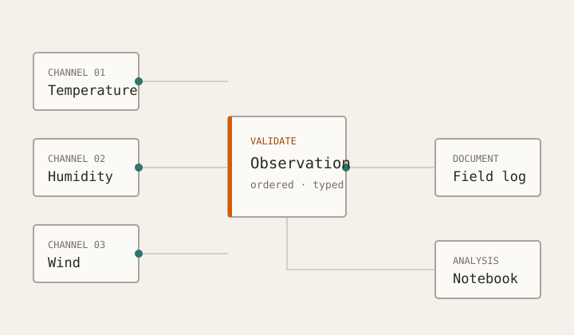

# Training report · image preview

[Results](#results) · [Notebook](document-images.ipynb#output-markdown) · [`Companion notes`](document.md#interpretation) · [重复标题](#训练结果-1) · `./document.md`

## Results

The following figures are synthetic fixtures, not training measurements.

## Unavailable and external images

## 训练结果

First result.

## 训练结果

Second result.
